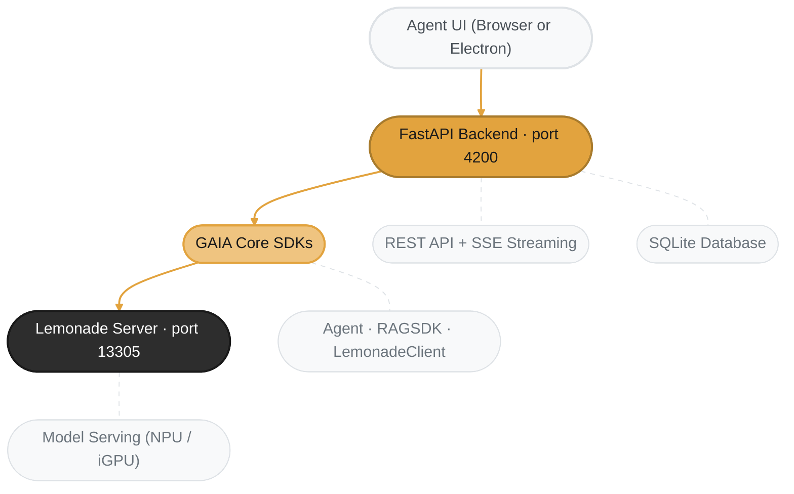

Ask your PC to find that contract you downloaded last month. Drop in a spreadsheet and get an instant analysis. Search across thousands of files in seconds. GAIA Agent UI is one chat window for the GAIA agent. It runs on your PC by default, and uses a cloud provider (Fireworks AI or the AMD LLM Gateway) only when you pick one of its models.

<Info>
  New to GAIA? Start with the [Quickstart](/quickstart) for first-time setup, then come back here.
</Info>

{/* TODO: once the demo asset is uploaded to assets.amd-gaia.ai, replace this
    placeholder with a <video> element pointing at the gaia-agent-ui-demo.webm
    asset (full URL omitted here so the docs link checker doesn't 404 on the
    not-yet-uploaded path).
*/}

**Two commands to get started:**

```bash
npm install -g @amd-gaia/agent-ui
gaia-ui
```

The first time it opens, the app sets itself up: it installs GAIA's local model server, downloads the models and checks they load, with each step shown in the window. No accounts or API keys are needed to run locally.

---

## What You Can Do

### Find Anything on Your PC

Ask the agent to locate files across your drives — by name, type, content, or recency. No more digging through folder trees.

> *"Find all Python files in my Downloads folder"*
>
> *"Show me the largest files on my Desktop"*
>
> *"Search my project for files that import pandas"*

The agent searches your common folders first, then offers a deep search across all drives if nothing turns up.

### Continue Work Across Turns

In-process chat agents retain file reads, tool calls and tool results for later
questions, including after the server restarts. Complete older turns leave the
model's context only when its estimated history budget fills; the transcript and
stored evidence remain on your machine. When more older turns leave the model's
view — a long chat, or a switch to a smaller model — the chat shows one quiet
line before the reply — "Older messages are now out of the model's view (N
turns)" — and the TUI shows the same line in its transcript. Ask GAIA to recall
anything from before it. A Hub-installed GAIA agent relayed from the Agent UI
sees only the last 5 exchanges, and the chat says so once, when the sixth one
lands. Earlier conversations saved before this feature retain text only.
If the current prompt leaves no history budget, GAIA warns and sends no older
turns; saved evidence remains intact. Switching to a model without native tool
calling replays recorded calls and results as text.

For Fireworks, AMD gateway, and catalog-discovered cloud models, history admission uses a conservative 64K
input budget, independent of local device settings and `GAIA_CTX_SIZE`; this is not
a claim about the remote model’s actual context capacity. The answer is written into
the provider's own window, so it takes nothing from those 64K. Claude uses its provider
budget.

With a cloud model selected, the model chip and the sidebar's location line name
the provider (for example **Fireworks AI**) instead of **Local**. They say
**Local** only when GAIA confirms the chat is answered on this PC, and make no
claim when it can't tell. Hover either for what is sent: the whole conversation,
including anything read out of files, documents or memory, which themselves stay
stored on your machine.

### See How Full the Context Is

The meter beside the model chip shows how much of the model's context window the
next message carries. Click it for the breakdown: system prompt, tools,
documents, conversation, and the room kept free for the reply. As the window
fills, a note above the message box names the oldest turns by their question
before they drop out of the model's view. They stay saved, and you can ask GAIA
to recall them.

For more, choose **Details: context & performance** in the meter's breakdown.
It opens the **Context & performance** section of the [session panel](#the-session-panel),
which shows what fills the window (system prompt, tool definitions,
skills, memory, documents, messages and free space), counted with the
model's own tokenizer when it is loaded and marked **approx.** when not. Tools
that load only when a turn needs them are listed apart. Below that, the panel
shows what is live in the window and, once GAIA has made room, how many older
tool results it moved out of the prompt. They stay readable, and GAIA reads them
again when needed. When the window fills up, the oldest turns may drop out of
the model's view; they stay saved, and you can ask GAIA to recall them.

**Under the hood** shows the last turn or the whole chat: where the model
runs, time to the first word, how fast it read the prompt and wrote the
answer, tokens in and out, how many were reused from the prompt cache, time
in the model against time in GAIA (tools, waiting on you, GAIA's own work),
tool calls, model loads, model memory and cost. Hover a number for the exact
value. Anything that was not measured says "unknown". The panel reads nothing
until you open it.

### Type While GAIA Works

You can keep typing while a reply runs. Press Enter and the message waits in a
queue above the message box, then goes out as its own turn as soon as the reply
ends, in the order you typed. To add a detail to the work already running, press
**Add to this reply** on a queued message: GAIA reads it at its next step
without starting over, though it may not answer it separately. If the reply
ends before reading it, it goes back in the queue. Press Stop and anything still
queued goes back into the message box.

Each chat keeps its own queue. Switch to another chat and the queued messages
still go out when their chat's reply ends, and the chat list shows how many are
waiting. They survive a reload of the app too. A message that can't be sent
stays in the queue marked **Not sent**, with the reason and **Send again**, and
the messages after it wait so the order holds. Deleting a chat deletes its
queued messages; the delete button says how many first.

### Compare Models on Your Question

To see how another model answers, use **Retry with…** on the latest answer and
pick a model downloaded on this PC. Both answers appear side by side with the
time each took and its speed. **Keep this answer** on either one, and the chat
continues from it. The other model answers from what the first reply already
gathered and doesn't run tools again. It loads after the first answer, since
the model server holds one model at a time, so the reported time includes
loading it. Your next message loads the chat's own model again.

### Analyze Any Document

Drag files into the chat — or just ask the agent to find them. It indexes the content and lets you ask questions, extract data, compare sections, or get summaries. Works with:

| Category | Formats |
|----------|---------|
| **Documents** | PDF, Word, PowerPoint, Excel, TXT, Markdown |
| **Data** | CSV, JSON, XML, YAML, HTML |
| **Code** | Python, JavaScript, TypeScript, Java, C/C++, Go, Rust, Ruby, Shell |
| **Config** | INI, CFG, TOML |

> *"Summarize this PDF in 3 bullet points"*
>
> *"Compare these two contracts and list the differences"*
>
> *"What's the total spend in this expense report?"*

---

## Install

Pick the install path that fits you best:

<Tabs>
  <Tab title="Desktop installer (easiest)">
    Prebuilt desktop installers are published on the
    [GitHub Releases page](https://github.com/amd/gaia/releases) alongside
    each tagged release. They bundle the Electron shell; Lemonade Server and
    the default model are downloaded automatically on first launch. This is
    the simplest path for non-developer end users.

    **Artifact naming** (`electron-builder.yml`):
    `gaia-agent-ui-<version>-<arch>-setup.<ext>` — e.g. `gaia-agent-ui-0.17.2-x64-setup.exe`
    and `gaia-agent-ui-0.17.2-amd64.deb`.

    **Windows (.exe):**
    1. Download **Install GAIA for Windows** from [amd-gaia.ai](https://amd-gaia.ai/#install) (`gaia-<version>-win-x64-setup.exe`) and run it.
    2. Tick **Desktop app** on Choose Components (and the terminal too, if you want it), then launch "GAIA" from the desktop or Start Menu (binary: `gaia-desktop`).
    3. Update by running the newer installer; it keeps your choices.
    4. Uninstall via Windows Settings → Apps → Installed apps → GAIA.

    See [Install GAIA](/guides/install) for silent installs. The desktop app's own installer, `gaia-agent-ui-<version>-x64-setup.exe`, is still on [Releases](https://github.com/amd/gaia/releases) for scripted installs of the app alone.

    **Ubuntu (.deb):**
    ```bash
    sudo apt install ./gaia-agent-ui-<version>-amd64.deb
    gaia-desktop
    # Update: apt install the newer .deb the same way.
    # Uninstall (apt package name is `gaia-desktop`):
    sudo apt remove gaia-desktop
    ```

    See the [Packaging & Distribution](/deployment/ui) page for more detail on
    the installers, supported platforms, and signing.
  </Tab>

  <Tab title="npm">
    The npm package handles everything — on first run it auto-installs Python, the GAIA backend, Lemonade Server, and a minimal model.

    **Requires:** [Node.js 20+](https://nodejs.org) (`winget install OpenJS.NodeJS.LTS` on Windows, `brew install node@22` on macOS)

    ```bash
    npm install -g @amd-gaia/agent-ui
    gaia-ui
    ```

    The Agent UI opens automatically at [http://127.0.0.1:4200](http://127.0.0.1:4200).

    | Flag | Description |
    |------|-------------|
    | `gaia-ui --port 8080` | Custom port |
    | `gaia-ui --no-open` | Don't auto-open the browser |
    | `gaia-ui --serve` | Serve frontend only (Node.js static server) |
    | `gaia-ui --version` | Show version |

    **Update:**

    ```bash
    npm install -g @amd-gaia/agent-ui@latest
    ```
  </Tab>

  <Tab title="Python CLI">
    If you already have GAIA installed via pip/uv:

    ```bash
    gaia --ui
    ```

    Or equivalently: `gaia chat --ui`

    The Agent UI starts on [http://127.0.0.1:4200](http://127.0.0.1:4200).

    | Flag | Description |
    |------|-------------|
    | `gaia --ui --ui-port 8080` | Custom port |
    | `gaia --ui --base-url http://192.168.1.100:13305/api/v1` | Connect to Lemonade on another machine |

    <Note>
      **Source/dev installs:** The frontend is built during `gaia init`. If you see a JSON response instead of the UI, run `gaia init` or manually build (from the repo root):

      ```bash
      cd src/gaia/apps/webui && npm install && npm run build
      ```
    </Note>

    <Note>
      If you see a missing dependencies error, run the install command it prints — it targets the Python that GAIA runs in. For the one-line installer's environment (which has no `pip` and is not activated) that is:

      ```bash
      uv pip install --python ~/.gaia/venv/bin/python "amd-gaia[ui]"
      # Windows: uv pip install --python "$env:USERPROFILE\.gaia\venv\Scripts\python.exe" "amd-gaia[ui]"
      ```
    </Note>

    **First run:** no separate setup command is needed. When the app opens on a
    PC that is not set up yet, it checks the PC (device, memory, disk), asks
    where GAIA runs, names the chat model it will download and its size (you
    can pick a smaller one first), then runs the same steps `gaia init` runs and
    ends on a few tasks to start with. If you choose a Lemonade Server you
    already run, setup uses it instead of installing GAIA's own. Running
    `gaia init` yourself beforehand also works.
  </Tab>
</Tabs>

### Uninstall

<Tabs>
  <Tab title="npm">
    ```bash
    npm uninstall -g @amd-gaia/agent-ui
    ```

    To also remove all GAIA data (sessions, config, downloaded models):

    ```bash
    # macOS / Linux
    rm -rf ~/.gaia

    # Windows (PowerShell)
    Remove-Item -Recurse -Force "$env:USERPROFILE\.gaia"
    ```
  </Tab>

  <Tab title="Python CLI">
    ```bash
    uv pip uninstall amd-gaia
    ```

    To also remove all GAIA data:

    ```bash
    # macOS / Linux
    rm -rf ~/.gaia

    # Windows (PowerShell)
    Remove-Item -Recurse -Force "$env:USERPROFILE\.gaia"
    ```
  </Tab>
</Tabs>

---

## The window

The app opens straight to an empty chat: a message box, the model it will use,
and where that model runs.

- **Sidebar:** New chat, search, **Memory**, **Scheduled tasks**, **Documents**,
  then your chats. **Needs you** at the top holds chats waiting on a permission
  or a question; **Pinned** comes next, then Today, Yesterday, Previous 7 days
  and older. A dot on each chat says whether it is running, waiting for you, done
  or failed, and a chat with a reply you haven't read shows in bold. Eval and
  scheduled runs are hidden behind **Show background runs** at the end of
  the list. At the bottom: where answers are generated right now (for example
  `Local · Gemma-4-E4B-it-GGUF` or `Fireworks AI · glm-5p3-flash`),
  notifications, mobile access and Settings. Collapse it with `Ctrl+B`.
- **Message box:** **+** attaches files (or drag them in), the shield picks the
  permission mode, the model chip picks the model, and Send turns into Stop
  while GAIA is working.
- **Tool steps** show as one quiet line ("3 steps · 1 tool") you can open for
  the detail. "Steps" is the agent's own count, the same figure the TUI and
  evals report.
- **The line under an answer** says how long it took, where it ran and when
  the first word came ("Answered in 40 s on your GPU · first word in 1 s", or
  "via Fireworks AI" for a cloud model). Click it for the exact numbers,
  including the tokens the whole turn read and wrote across every model call.
  Files the answer names by full path,
  such as a saved deliverable, open in your file explorer when clicked.
- **A new chat** greets you, shows the folder GAIA works in, and offers up to
  four tasks from the skills you have and what you've set up (indexed
  documents, a connected mail account). A task with a subject to fill in is
  typed into the message box; the others start straight away.
- **The session panel** on the right keeps the facts about this chat in view;
  see [The session panel](#the-session-panel).
- **"Loading Qwen3.6-35B-A3B on your GPU… 12s"** under the message box means
  the model is loading and reading GAIA's instructions ahead of your first
  message, so that message gets a quick answer. You can type and send
  meanwhile; a message sent early waits for it to finish rather than starting
  over.

Every chat runs the GAIA agent. Chats made by the retired `chat`, `doc` and
`file` agents stay readable but can't be continued; start a new chat instead.

## The tray icon

The desktop app keeps an icon in the system tray (the menu bar on macOS). Its
badge shows what GAIA is doing, by shape as well as colour:

| Badge | Meaning |
|---|---|
| None | Idle |
| Open ring | Writing an answer |
| Hourglass | Waiting for the model: loading it, downloading it, or retrying it |
| Solid dot | A chat needs you: an approval or an answer to a question |
| Triangle | Something is wrong: GAIA's service or the model server isn't running |

Hover for a tooltip such as *GAIA — answering in 'Trip plan'*. On Linux, where
most trays show no tooltip, the first line of the menu says the same thing.
On Windows, the taskbar button also shows a dot when a chat needs you or a
notification is unread.

The menu:

- **Status line**, for example `Gemma-4-E4B-it on GPU · idle`.
- **Needs you**: each chat waiting on you. Click one to open it.
- **New chat** and up to five **Recent** chats.
- **Show GAIA**.
- **Free memory…** unloads the chat model to give its memory back, after
  asking. Your next message loads it again. It is greyed out, with the reason,
  while an answer is running in this window, when no model is loaded, or when
  the model runs in the cloud. If an answer elsewhere or a document index still
  needs the model, it says so instead of asking.
- **Settings…** and **Quit GAIA**.

The first time you close the window, GAIA says once that it is still running
in the tray. If you quit, or choose **Restart now** for an update, while an
answer is being written or a document is indexing, GAIA asks first and says
that the answer will be lost; when idle it doesn't ask. Keeping GAIA running
puts an update off until you next quit.

**Settings → General → Desktop app** has three switches, each applied as soon
as you flip it:

- **Keep running when the window closes**: close hides the window instead of
  quitting.
- **Start GAIA when you sign in.** On Windows this is the startup entry the
  installer adds, so it starts on; once you turn it off, an update or reinstall
  doesn't turn it back on. It also follows Task Manager → Startup apps. On Linux
  this writes `gaia-agent-ui.desktop` to `$XDG_CONFIG_HOME/autostart` (usually
  `~/.config/autostart`). If the system refuses, or macOS waits for your
  approval in System Settings → Login Items, the switch stays off and says why.
- **Start in the tray**: every launch opens without the window. Takes effect
  from the next launch. On Windows a launch at sign-in always starts in the
  tray.

## Models and where they run

Open **Settings → Model** (or the model chip in the message box):

| Provider | What it needs | Where your chat goes |
|---|---|---|
| **Local** | Nothing; pick CPU, GPU or NPU for new chats | Stays on this PC |
| **Fireworks AI** | An API key | Sent to Fireworks AI (usage may be charged) |
| **AMD LLM Gateway** | A gateway key (and URL, if not the default) | Sent to your gateway |

- Keys are masked, go only to GAIA's local model server and your OS credential
  store, and are refused over mobile access. When a key is already set (in the
  environment or from the TUI) the screen says so; leave the field blank to keep
  using it. **Forget key** removes it here and for future sessions.
- Recommended Fireworks models are ranked first, each with the benchmark result
  behind the pick.
- The model you choose is remembered across restarts (shared with the TUI). If
  it can't be restored, a one-line notice says why and asks you to pick one.
- Switching from a local model to a cloud one shows the privacy note first.

### When GAIA's model server runs

Local chat runs on GAIA's own Lemonade Server, the one `gaia init` installs.
GAIA manages it for you, and it gives its memory back when you stop using GAIA:

| When | What happens |
|---|---|
| You open the app (desktop, `npx @amd-gaia/agent-ui`, or `gaia-tui`) | GAIA's background service starts the server if it is not running |
| You close the last GAIA app | Every model is unloaded, so your GPU memory is free again. The server itself stays up for a quick next launch |
| Another GAIA process is still using it, or a request is in flight | Nothing is unloaded until it is done |
| No GAIA process has held it, and it has served no request, for 15 minutes | The server stops entirely |
| A GAIA process sends a request after it stopped | It starts again and the request goes through, after a cold model load |
| `gaia daemon stop` | The server stops, including the one first-time setup started |

Every GAIA process that talks to the server holds a lease on it while it
runs: the app, each `gaia` command, sidecar agents, and a process started with
another `GAIA_HOME` that points `LEMONADE_BASE_URL` at this server. The server
is never stopped while a lease is held or a request is in flight.

The server keeps the same port from one start to the next, and moves only if
another program has taken it. Its API key still changes on every start; read
the current one from `~/.gaia/lemonade/env.sh` (`env.ps1` on Windows).

Fifteen minutes balances giving the GPU memory back to other apps against
the cost of a cold model load, about 20 to 60 seconds, the next time you use
GAIA. Change it, or turn the timeout off with `0`:

```bash
gaia config set lemonade_idle_timeout_minutes 30
```

The new value applies within seconds; no restart is needed.

None of this applies to a Lemonade Server you run yourself and point GAIA at
with `LEMONADE_BASE_URL`: GAIA never unloads its models or stops it.
### Which server and which GPU backend

**Settings → Advanced → Model server** shows what is actually running:

- **Server**: GAIA's own Lemonade or yours (another Lemonade on this PC, or one
  on another machine), with its version.
- **Address**: the URL and port GAIA talks to.
- **Chat model** and **Runs on**: the loaded model and its llama.cpp backend
  (Vulkan, ROCm, CPU), NPU, or *Remote (cloud)*. "Lemonade's default" means the
  load did not name a backend and Lemonade picked it. *unknown* means this
  Lemonade does not report it.
- **Context window** and the **Embedding model** with its backend.

To choose the backend, pick **Auto**, **Vulkan**, **ROCm** or **CPU** under
*llama.cpp backend for chat models*. Only backends Lemonade can run on this PC
are listed; one marked "downloads on first use" is fetched by Lemonade the
first time it loads (ROCm is about 4 GB). The choice applies the next time the
chat model loads; **Reload chat model now** applies it at once. The embedding
model keeps its own backend.

The same setting from a terminal:

```bash
gaia config set llamacpp_backend rocm   # vulkan | rocm | metal | cpu | auto
```

**Change model** opens Settings → Model. To use a different server, set
`LEMONADE_BASE_URL`.

## Permissions

GAIA asks before it changes files, runs commands or uses tools that act for you.
The question appears above the message box with three answers:

- **Allow once**
- **Always allow** *this exact action* in this chat (offered only when the action
  is narrow enough to name, e.g. *writing notes.md*)
- **Deny**

When the same question comes back after you allowed it once, the prompt says
so and highlights **Always allow**. It never answers for you, and a different
tool or a riskier call gets no hint.

Pick **Full access** from the shield to let a chat run everything without
asking (you confirm once). **Settings → Permissions** lists every chat with full
access or "always allow" answers and lets you revoke them. Grants end when GAIA
restarts.

A Hub-installed GAIA, which runs as its own process, follows the chat's mode
too, from agent contract 2.14. It stops asking, but its shell guardrails stay
on. If the mode can't be passed on when a turn starts, that turn stops with an
error, so it never runs with full access you turned off.

## The session panel

Each chat has a panel on the right that keeps the important facts in view:
what the latest answer used, where the chat runs and what it may touch, what
fills the context, what the chat produced, and what it changed. Show or hide it
with the panel button at the right of the chat's title bar. Drag its left edge
to resize it (or focus the edge and use the arrow keys); the width, whether it
is open, and which sections are expanded are remembered. On windows narrower
than about 1,100 px it opens on top of the chat instead, and Escape closes it.

The panel reads when it opens, when you expand a section, and when an answer
finishes. It never checks on a timer, and a closed panel or a collapsed section
reads nothing.

- **This answer** shows what the latest turn used and where its data went:
  - **Sources:** the web pages it read and the document passages it drew on,
    named by file and page.
  - **Files:** what it created or changed, with **Open** and **Show in
    folder**. Scripts, programs and web pages offer only Show in folder,
    because opening them would run code. A file deleted since the turn shows
    as no longer on disk, and one changed since then says so.
  - **This turn:** where the model ran (**This PC**, or the cloud provider
    such as Fireworks AI or the AMD LLM Gateway), whether your documents
    stayed here, which websites GAIA's web tools contacted, and the cost (a
    list-price estimate for Fireworks models).

  While a new turn runs, it says the answer is in progress rather than showing
  the previous one. When every web lookup in a turn failed, it says **Couldn't
  get live data**, so you know the answer isn't based on current information;
  with the panel closed, its button turns amber.
- **Environment** shows where the chat runs and what it may touch. Each change
  applies from GAIA's next step, without a restart:
  - **Runs on:** this PC with its device and backend (for example
    `GPU · Vulkan`), the model and the memory in use, or the cloud provider.
  - **Can read and write:** the folders and files GAIA may use in this chat,
    and where each came from. **Add folder** gives it another folder;
    **Remove** takes one away. A removed folder is refused by every file and
    shell tool, even under full access and even inside a wider folder, until
    you add it back. A document attached to the chat is removed from the
    document bar instead, which also takes it out of the chat's search.
  - **Internet:** turn it off and GAIA won't search the web, open pages,
    use the browser or connectors, or run commands that go online (such as
    `git push`, `pip install` or `npx`). Commands that talk only to this PC,
    such as `curl http://localhost:3000`, still run. The check reads what a
    command names, so a script that connects to the internet by itself (for
    example `python fetch.py`) can still reach it. The message box says the
    chat is offline, with a button to turn it back on.
  - **Phone access:** turns mobile access on or off, shows the QR code, and
    names the phone that connected.
  - **Permission mode:** Ask or Full access, the same setting as the shield in
    the message box.

  An agent that runs as its own process, such as the email agent, isn't held
  to the folder and internet settings, and the section says so instead of
  offering them.
- **Context & performance** is the breakdown described in
  [See how full the context is](#see-how-full-the-context-is).
- **Outputs** lists everything the chat produced, newest first: files created
  or changed, exports (PDF, Word, Excel, CSV and similar), images, documents
  indexed, scheduled tasks and memories saved. Each shows when it was made and
  **Go to turn** scrolls to the answer that made it. Files have **Open** and
  **Show in folder**, with the same rule as above for scripts and web pages.
  Items an undo removed show as **Undone**.
- **Changes** appears once the chat has changed files. It totals them, such as
  "4 files changed, +120 −8", and lists each file with the turns that touched
  it.
  - **Review changes** shows each file as one diff, from before the chat's
    first turn to after its last.
  - **Undo all** puts every file the chat changed back as it was before the
    chat, after you confirm. Like undoing one turn, it is all or nothing: if a
    file changed outside GAIA since, it names the file and changes nothing
    until you choose to undo anyway.
  - When the files are in a git repository, **Commit** and **Create PR** open
    a message drafted from your requests in this chat, which you can edit.
    Nothing runs until you press the button in that dialog, whatever the
    permission mode. Commit includes only the files this chat changed, and
    leaves out any that git ignores (the dialog names them) or that sit in a
    folder you removed.
    Create PR pushes the current branch (never forced) and opens the pull
    request with GitHub's `gh` tool; it isn't offered from the default branch
    or while the chat's internet is off.

## Undo a turn

Before GAIA changes a file, it saves a copy. When a turn changed files, its
answer shows **Review changes** and **Undo this turn**:

- **Review changes** shows what the turn did to each file, as a diff.
- **Undo this turn** puts every file back as it was before the turn: edited
  and deleted files get their old contents, new files are removed. It works
  after GAIA restarts too.

Undo is all or nothing. If you, or a later turn, changed one of those files
since, GAIA names it and changes nothing; you can then undo anyway and lose
that later change. Undo the later turn first to keep it. To undo every turn at once, use
**Undo all** in the session panel's Changes section.

GAIA can't copy what a shell command, a Python snippet or a connected (MCP)
tool is about to change. When a turn ran one that could have changed files,
the answer says so — "GAIA ran 2 Python snippets it can't track" — and lists
them, identical ones once. A snippet or script is left out only when GAIA can
tell from its code that it just reads files, and no files changed in the folders
it ran in. When in doubt — a library GAIA doesn't know, a file opened in a mode
it can't read off the code — it is listed.

**Settings → Privacy → Undo history** sets how long copies are kept (7 days by
default) and how much space they may use (500 MB, oldest first), and shows how
much they use now.

## Settings

One window with General (appearance: Light, Dark, Match system; colors; the
[desktop app's tray switches](#the-tray-icon); shortcuts),
Model, Permissions, Skills (what GAIA can load, with **Use** to try one),
Connectors, Memory, Notifications, Privacy and Advanced (model server and
llama.cpp backend, custom model ID, beta options, MCP servers, version and roll
back).

**Settings → Model** lists each local model with where it runs, such as
"GPU · Vulkan" or "NPU · FLM". You don't pick the device: each model is built
for one. A loaded model shows the device Lemonade reports for it, and says so
plainly if that isn't the expected one (a GPU model that fell back to the CPU
runs slowly). Each row also shows whether the model fits this PC, its download
size and the speed measured here. Models this PC can't run are under **Not
available on this PC**, with the reason. **Context size** goes up to the
largest window that fits; **Automatic** is GAIA's choice, and a size you pick
is kept for that model.

The model chip in the composer opens the same list. While GAIA is answering,
a model you pick there applies to your next message. The **Local · model** pill
at the bottom of the sidebar shows whether the model is loaded, warming up or
stopped, where it runs, memory in use and free, and its context window, with a
**Restart** button. On a Lemonade you run yourself, GAIA asks before Restart
reloads its model and never starts that server for you.

**Settings → Notifications** picks, for each event (needs your approval, has a
question, finished), a **Banner**, a **Badge** only, or **Off**, plus a sound
and a taskbar flash when GAIA isn't focused. Alerts fire whether or not the
notification panel is open, and never for the chat you're looking at. In the
desktop app it also keeps the PC from idle-sleeping while a chat is working; on
battery it lets the PC sleep below the level you choose (20% by default).

**One chat at a time on the model.** A second chat sent while another is
working waits its turn and says so ("Waiting for the GPU — 1st in line", also
on its row in the sidebar), then runs when the first finishes. **Stop** takes a
waiting chat out of the line.

**Colors** keeps the warm gray look by default. Pick one of eight palettes
instead (Stone and ink, Blue marble, Glacier, Forest floor, Sage and mist,
Basalt and lichen, Graphite and gold, Dusk), or **Custom** to choose your own
accent and background tint. Each works in light and dark, and with custom
colors the text shades adjust on their own so everything stays readable.

Before you pick a cloud model, setup and **Settings → Model** show what it
costs per million tokens at the provider's list price; a model with no
published price says "price unknown". **Settings → Model** also shows what
this month's cloud chats have cost and lets you set a monthly limit. GAIA warns
when you're close, and once you reach it, it stops before sending a chat to the
cloud and tells you how to go on: raise the limit, allow more for this month,
or use a model on this PC. The total is an estimate at list price: it leaves
out cache discounts, and turns that fail or are stopped before a reply, so
your provider's bill is the final word.

**Settings → Advanced → Model server** switches between GAIA's own Lemonade
Server and one you already run: enter its address (and its API key, if it needs
one) and choose **Use this server**. The setup screen offers a Lemonade it finds
running the first time. GAIA never changes your server's setup: connecting a cloud
provider uses the one your server already has, and says so if it has none. **Use
GAIA's own** is refused, with nothing changed, when GAIA's own server isn't
installed; `gaia init --gaia-lemonade` installs it and switches. See
[Use a Lemonade you already run](/guides/install#use-a-lemonade-you-already-run).

## Roll back to a previous version

If an update introduces a regression, you can roll back to a specific earlier release directly from the app — no need to hunt down an old installer on GitHub.

**How to roll back (desktop installer only):**

1. Open **Settings → Advanced**.
2. Click **"Roll back to a previous version"**.
3. The app fetches the list of published releases from GitHub and shows them newest-first, with your currently installed version marked.
4. Click an older release to open a confirmation step.
5. Confirm — the app downloads the selected version and shows a native "Restart now?" prompt when ready. Click Restart and the older version launches.

**Version pinning (AC2):** After a manual rollback, auto-update is automatically paused. The About section shows "Auto-update paused (pinned to vX.Y.Z)" so you know it's held. Click **Resume updates** in the same section to re-enable normal auto-updates.

### Platform support

| Platform | Rollback support |
|----------|-----------------|
| Windows (NSIS installer) | Full — download + reinstall works end-to-end |
| macOS (DMG/ZIP, signed builds) | Works on signed release builds; unsigned dev builds download but cannot apply the update |
| Linux AppImage | Supported (self-replacing) |
| Linux .deb | Not supported via in-app rollback — use `sudo apt install ./gaia-agent-ui-<version>-amd64.deb` from [Releases](https://github.com/amd/gaia/releases) |

<Note>
The rollback list only shows releases that have an installer for your current platform. Releases without a matching artifact are filtered out automatically.
</Note>

---

## Sessions and Shortcuts

Sessions let you organize conversations by topic. They sync between the CLI (`gaia chat`) and the Agent UI — start in one, pick up in the other. Export any session as Markdown or JSON from the session menu.

| Shortcut | Action |
|----------|--------|
| `Enter` | Send message |
| `Shift+Enter` | New line |
| `Escape` | Stop agent response |
| `Ctrl+K` | Search chats |
| `Ctrl+Shift+O` | New chat |
| `Ctrl+B` | Show or hide the sidebar |
| `Ctrl+,` | Settings |

When GAIA asks permission, the prompt takes focus and `Enter` does nothing, so a message you were typing can't approve it. `Escape` denies (it takes priority over stopping the reply); `Tab` to **Allow once** or **Always allow** and press `Enter` or `Space` to approve. The prompt counts down the time the agent will wait, and GAIA denies when it runs out.

---

## Long Responses

A chat reply has no time limit while the agent is making progress: model output, a tool starting or finishing, any step. A running tool, or a question or permission prompt waiting on you, also counts, since each has its own time limit. A model that stops sending is handled by GAIA's model-stall check, which ends and retries the request.

GAIA stops a reply only after 75 minutes with no progress at all, and the reply says so: "This turn ran for 75 minutes without progress, so GAIA stopped it." Anything finished before then is kept; send "continue" to pick up where it left off. Change the window with `GAIA_STREAM_TIMEOUT`, set before GAIA starts:

```bash
export GAIA_STREAM_TIMEOUT=7200   # seconds without progress; whole number from 1 to 86400
gaia chat --ui
```

An invalid value (not a whole number, or out of range) stops the Agent UI server at startup with an error naming the variable, rather than quietly using the default.

**If the PC sleeps mid-reply,** the time it spends asleep doesn't count toward this limit, the model-stall check, a running tool's time limit or the retry budget, so the reply isn't cut off the moment the PC wakes. A local model and a running tool pick up where they left off. A hosted model's connection may have dropped during the sleep; that is handled like any other dropped connection. A model that stays silent after the PC wakes is still caught.

---

## Close, Quit and Restart

Chats, documents and schedules are saved on disk as you go. What happens to work in progress depends on what stopped:

| What happened | A reply being written | A document being indexed |
|---------------|-----------------------|--------------------------|
| You switch chats or close the browser tab | Keeps going; reopen the chat to watch it finish | Keeps going |
| You close the desktop window | Keeps going: the window hides to the tray (unless you turned that off) and GAIA keeps running | Keeps going |
| You quit GAIA, it crashes, or the PC shuts down | Stops. On the next start the reply shows what it had written so far, which tools it had started, then "This answer was interrupted when GAIA closed. Send again to retry." A scheduled run cut short shows the same in its chat. | Stops. On the next start it shows as **Failed** with **Retry**, and "Indexing was interrupted when GAIA closed" under the document |

GAIA never re-runs an interrupted reply by itself: it may already have run tools, and running them twice is not safe. Send the message again to retry.

---

## Memory

The agent can remember facts, preferences, and decisions across sessions. Memory is **on by default (beta)** — see the [Agent Memory guide](/guides/memory) to learn more. Turn it off in **Settings → Memory**, and open **Memory** in the sidebar to search, edit or forget what GAIA remembers.

---

## Scheduled Tasks

Run a prompt on a recurring schedule — "every morning at 9, summarize my inbox" — without leaving the UI. Click **Scheduled tasks** in the sidebar to open the Schedule Manager.

Describe the schedule in natural language; the parser previews the interpretation live before you create it:

| Input | Meaning |
|-------|---------|
| `every 30m` | Every 30 minutes |
| `every 6 hours` | Every 6 hours |
| `daily at 9pm` | Once a day at 21:00 |
| `every monday at 8am` | Weekly on Mondays at 08:00 |
| `every hour from 8am to 6pm` | Hourly inside a time window |

Each schedule runs in its own chat session, so the full history of runs (prompt + response per run) is one click away via the session list. Pause, resume, or delete schedules from the panel; run counts and the next-run countdown update live.

Behavior notes:

- Scheduled runs use the GAIA agent and the model you picked; with a local model nothing leaves your machine.
- Runs are **suspended while mobile access (tunnel) is active**, matching the autonomous agent loop's security posture. Set `GAIA_AUTONOMOUS_ALLOW_TUNNEL=1` to override.
- One run executes at a time; overlapping schedules queue.
- Per-run timeout defaults to 300 s; override with `GAIA_SCHEDULE_TIMEOUT`.
- A schedule keeps its next run time across a restart of GAIA. The most recent run that came due while the PC was off or asleep, or GAIA was closed, still runs if GAIA is back within an hour of it; every other one shows in the run history as "Missed … while the PC was off or asleep, or GAIA was closed" and is not run late. Each run is taken by one GAIA server, so two servers sharing a chat database never run it twice, and a pause in one stops it in both. The first start after updating to this version counts nothing before itself: older versions restarted a task's timer on every restart, so their gaps are not blamed on the PC.
- Times are your local time, taken from the browser's time zone, and stay put across daylight-saving changes. A time skipped when clocks jump forward runs just after the jump; a time repeated when they fall back runs once. Schedules made before this was fixed were read in UTC; they move to this PC's time zone on the next start.

The REST API lives at `/api/schedules` (create/list/get), `/api/schedules/{name}` (pause/resume/cancel via `PUT`, delete via `DELETE`), `/api/schedules/{name}/results` (run history), and `/api/schedules/parse` (natural-language preview).

---

## Policy Alerts and Receipts

When a governance-enabled agent blocks a tool call, the Agent UI shows a
non-actionable policy alert instead of an approval prompt. Policy blocks appear
as inline **Policy Shield** activity cards, critical notifications, and a toast
with a **View receipt** link when a receipt ID is available.

Policy alerts are durable session history. If you reload the UI or reconnect
after a blocked request with no assistant text, the block reason, rule IDs,
policy version, and receipt ID remain attached to the assistant message.

---

## Extend with MCP

The agent supports the **Model Context Protocol** in both directions — connect external tools to expand what the agent can do, or expose the Agent UI itself so other AI tools can drive it.

<CardGroup cols={2}>
  <Card title="Add Tools to the Agent" icon="plug" href="/guides/mcp/client">
    Connect GitHub, Slack, databases, and more via MCP servers
  </Card>

  <Card title="Expose Agent UI to Other Tools" icon="server" href="/guides/mcp/agent-ui">
    Let Claude Code, Cursor, or any MCP client control GAIA agents
  </Card>
</CardGroup>

<Warning>
  Misconfigured MCP servers can cause slow responses. If you experience timeouts, check `~/.gaia/mcp_servers.json` and remove any servers you don't need. See [Troubleshooting](#llm-response-times-out-or-fails) for details.
</Warning>

---

## Troubleshooting

<AccordionGroup>
  <Accordion title="Lemonade Server not running">
    You shouldn't have to start the model server yourself — `gaia daemon` starts and supervises it. So the question is why that didn't happen.

    ```bash
    gaia daemon status            # the daemon reports the model server it supervises
    gaia daemon start             # if no daemon is running
    gaia daemon logs --lines 100  # daemon up but no model server — the reason is here
    ```

    The usual cause is that GAIA isn't set up yet. The app shows its setup steps in that case; `gaia init` from a terminal does the same.
  </Accordion>

  <Accordion title="No model loaded">
    ```bash
    gaia download --agent chat
    ```
  </Accordion>

  <Accordion title="Port 4200 already in use">
    ```bash
    # npm CLI
    gaia-ui --port 8080

    # Python CLI
    gaia --ui --ui-port 8080
    ```
  </Accordion>

  <Accordion title="Database locked error">
    Close any other GAIA Agent UI or CLI instances. Only one writer at a time is supported.
  </Accordion>

  <Accordion title="Document indexing fails">
    - The reason shows under the document in the library. A damaged, password-protected or scanned (no text) PDF is marked **Can't be read**: retrying won't help until you re-export the file, remove the password or run OCR on it
    - Ensure the file is a supported format and does not need a password to open (PDFs with only permission restrictions index fine)
    - Keep file size under 100MB
    - For PDF image extraction, download the VLM model: `gaia download --agent chat`
    - Two large documents index at a time and the rest wait their turn; small files (under 20 MB) have their own two slots, so they never wait behind big ones. A document that keeps making progress indexes to the end however long it takes. One that makes no progress for 10 minutes stops with an error that says so; to allow longer stalls, set `GAIA_INDEX_TIMEOUT` (seconds without progress) before GAIA starts, e.g. `export GAIA_INDEX_TIMEOUT=1200`
  </Accordion>

  <Accordion title="Access denied: GAIA only reads documents under ...">
    Documents can only be read from an allowed root. By default that is your
    home directory — a path elsewhere on disk is rejected with HTTP 403. GAIA
    gives the same answer whether or not a file exists there, so it can't be
    used to probe the rest of the disk: if the path might be mistyped, check it
    first. A missing file inside an allowed root says it doesn't exist.

    This bites on service accounts and CI runners, whose home
    (`C:\Windows\System32\config\systemprofile`) is not where their files live.
    Add the extra directory before starting the server:

    ```bash
    # POSIX — separate multiple roots with ':'
    export GAIA_DOCUMENT_ROOTS=/srv/corpus
    ```
    ```powershell
    # Windows — separate multiple roots with ';'
    $env:GAIA_DOCUMENT_ROOTS = "C:\actions-runner\_work\gaia\gaia\eval\corpus"
    ```

    Each entry must be an absolute path to a directory that exists; a relative
    or missing one fails the request with HTTP 500 rather than being ignored.
    The containment check still applies — declaring a root widens access to
    that root only, never to its parent, and a symlink escaping it is still
    rejected.

    Two limits worth knowing before you set this:

    - A declared root is **browsable and previewable, but not searchable**.
      File search and "open in file manager" still only look at your home
      directory, so files under a declared root are reachable by path but will
      not turn up by name.
    - The roots apply to **every client of the backend**, including one
      reaching it over the tunnel feature. Declare only what you would be
      comfortable serving remotely.
  </Accordion>

  <Accordion title="First-run network egress to huggingface.co">
    The first time you index a document, Lemonade Server pulls the embedding
    model (`user.embeddinggemma-300m-GGUF`, ~334 MB) from `huggingface.co`,
    cached under `~/.cache/huggingface/hub/`. Subsequent runs are offline.

    If your environment blocks `huggingface.co`, pre-seed the cache on a
    machine with internet access and copy it to the target machine, or set
    `HF_HOME` to point at a pre-populated cache directory before launching
    the UI.
  </Accordion>

  <Accordion title="Frontend shows JSON instead of the UI">
    The Agent UI frontend has not been built.

    **npm install (`gaia-ui`):** This is handled automatically — `gaia-ui` tells the Python server where to find the pre-built frontend. If you still see this error, try reinstalling: `npm install -g @amd-gaia/agent-ui@latest` Then restart with `gaia-ui`.

    **Source/dev installs (git clone):** Run `gaia init` to build it automatically, or manually (from the repo root):

    ```bash
    cd src/gaia/apps/webui && npm install && npm run build
    ```

    Then restart `gaia chat --ui`.

    **pip/PyPI installs (without gaia-ui):** Use the [npm install path](#install) — the pip package does not include frontend source files.
  </Accordion>

  <Accordion title="LLM response times out or fails">
    If you see "I wasn't able to generate a response" errors, check your MCP server configuration. Misconfigured or unreachable MCP servers cause the agent to wait up to 10 seconds per server before responding.

    Check your config:

    ```bash
    # macOS / Linux
    cat ~/.gaia/mcp_servers.json

    # Windows (PowerShell)
    Get-Content "$env:USERPROFILE\.gaia\mcp_servers.json"
    ```

    If it contains servers you don't recognize or aren't running, either remove them or reset the file:

    ```json
    { "mcpServers": {} }
    ```

    You can also manage MCP servers through the Agent UI settings panel or with the CLI:

    ```bash
    gaia mcp status
    ```
  </Accordion>
</AccordionGroup>

---

## Architecture



For the REST API reference and backend classes, see the [Agent UI SDK Reference](/sdk/sdks/agent-ui).

---

## Next Steps

<CardGroup cols={2}>
  <Card title="Agent UI SDK Reference" icon="code" href="/sdk/sdks/agent-ui">
    REST endpoints, database schema, and Python backend API
  </Card>

  <Card title="Document Q&A Agent" icon="file-lines" href="/guides/chat">
    CLI-based document agent with RAG, debug mode, and chunking strategies
  </Card>

  <Card title="Build Your First Agent" icon="rocket" href="/quickstart#build-your-first-agent">
    Create a custom agent with tools in minutes
  </Card>

  <Card title="MCP Server" icon="plug" href="/guides/mcp/agent-ui">
    Connect Claude Code, Cursor, or any MCP client to the Agent UI
  </Card>
</CardGroup>

---

<Note>
  **Hardware:** Tested on AMD Ryzen AI MAX+ 395 with Qwen3.5-35B-A3B-GGUF via Lemonade Server. Other configurations may work — [report issues here](https://github.com/amd/gaia/issues/new).
</Note>

<small style="color: #666;">

**License**

Copyright(C) 2024-2026 Advanced Micro Devices, Inc. All rights reserved.

SPDX-License-Identifier: MIT

</small>
