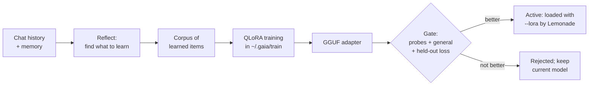

Memory lets GAIA *look up* what it knows about you. Nightly learning puts it into the model's weights. Each night, while you're away, GAIA reads what it learned from your chats, trains a LoRA adapter for the local chat model on your GPU, and tests it. It keeps the adapter only if the adapter answers your questions better than the model you had yesterday and gets nothing worse. In the morning the new adapter is already loaded.

Nothing leaves your PC: the history, the training data, the training run and the adapter all stay local.

<Warning>
  **Preview.** Nightly learning is off by default and currently supports one chat model, `Gemma-4-E4B-it-GGUF`. Training needs an AMD GPU with ROCm PyTorch support: a Ryzen AI Max (Strix Halo) or a Radeon RX 6000–9000. NPU-only and CPU-only PCs can't train.
</Warning>

## What it learns

Each cycle looks for four kinds of thing in your recent history:

| Kind | Where it comes from | What the adapter learns |
|------|--------------------|-------------------------|
| **Preference** | A preference you taught GAIA ("remember: I want times in UTC") | To apply it without being reminded |
| **Concept** | A fact about your world you taught GAIA: projects, jargon, systems, people | To know it, the way it knows general facts |
| **Faster workflow** | A turn where GAIA made failed or repeated tool calls before the one that worked | To make the right call first |
| **Correction** | You told GAIA an answer was wrong and it then got it right | The right answer the first time |

Preferences, concepts and corrections are expanded into several varied question-and-answer pairs by the base model itself, so the adapter learns to *use* the fact rather than recite one sentence.

Some things are never learned:

- Private chats, and every chat while memory is turned off.
- Memories marked sensitive, and memories GAIA extracted on its own from a conversation. Only what you taught it counts, because an extracted memory can carry text GAIA read from a web page or email.
- Turns where GAIA read outside content (web pages, email, feeds), so text injected into that content can't end up in the weights.
- Anything you asked GAIA to forget. If the adapter in use learned it, that adapter is switched off at once, and the next one is trained without it.

## The gate: an adapter must earn its place

Every learned item comes with held-out *probe* questions. A probe is kept only if the base model, shown the fact, can answer it, so a failure measures what wasn't learned rather than a badly worded question. Before and after training, GAIA asks every probe of the model exactly as Lemonade serves it: the quantized GGUF, with no memory or system prompt to help. It also asks a fixed set of general questions.

A new adapter becomes active only if all of these hold:

1. It answers more learned probes than the model it would replace (the base model, or yesterday's adapter).
2. It answers every general question the base model gets right.
3. Its loss on held-out training examples is below the base model's.

Otherwise it is kept on disk as *rejected* and nothing changes.

## Set it up

<Steps>
  <Step title="Install the training toolchain (once)">
    ```bash
    gaia learn setup
    ```
    This builds a separate environment in `~/.gaia/train` with AMD's ROCm PyTorch for your GPU, PEFT and bitsandbytes for 4-bit QLoRA, and llama.cpp's LoRA converter at the same commit as Lemonade's llama.cpp. It downloads several GB and never touches GAIA's own environment. The first training run also downloads the model's full-precision weights (about 16 GB for Gemma 4 E4B).
  </Step>
  <Step title="Pick the model to personalise">
    ```bash
    gaia learn config --base-model Gemma-4-E4B-it-GGUF
    ```
    Skip this if Gemma 4 E4B is already your default chat model.
  </Step>
  <Step title="Turn it on">
    ```bash
    gaia learn enable
    ```
    The GAIA daemon checks every 15 minutes. A cycle starts once a night, inside the window (01:00–06:00 by default), after 30 minutes with no chat, and on a laptop only on mains power. Change any of these with `gaia learn config`.
  </Step>
</Steps>

To try it right away instead of waiting for the night:

```bash
gaia learn analyze      # what it would learn, without training
gaia learn run          # one full cycle now
gaia learn status       # progress, and the result
```

If you come back while a nightly cycle is running, it stops and puts back the adapter you were using. A cycle you start yourself stops only if you chat during training or testing. `gaia learn stop` stops either kind.

## Manage it in the Agent UI

Open **Nightly learning** in the sidebar. It shows:

- the on/off switch, the time window and the power setting
- the latest run, live while it trains, and what it found that night
- every adapter with its scores. Expand one to compare the base model's answers to the adapter's, probe by probe, and roll back to an older one with **Roll back to this**
- everything learned so far, with **Forget** on each item (forgetting switches off an adapter that learned it)

**Use the base model** switches the adapter off without deleting anything.

## Try the Jordan scenario

`util/learning_scenario.py` gives one night's learning a reproducible test. Jordan is a release engineer on a project called Halcyon. The script writes a week of their history into a fresh, isolated GAIA home, through GAIA's own stores:

- two preferences (severity-tagged incident summaries, UTC times)
- three concepts no base model can know (the "Thursday rollup", the Bluefleet/Redfleet clusters, the HAL-7 rota)
- a correction (the artifact cache's port)
- a build-status lookup the agent did the slow way three times

Then it runs one cycle exactly as the nightly job would and prints the morning report: every probe asked of the base model and of the new adapter, side by side.

```bash
python util/learning_scenario.py --home C:/gaia-scenario
```

It needs `gaia learn setup` and a running Lemonade with `Gemma-4-E4B-it-GGUF`, and takes about 15 minutes on a Ryzen AI Max+ 395. It never touches your own `~/.gaia`, and it reloads the base model without the scenario's adapter when it ends.

One run on a Ryzen AI Max+ 395 (Radeon 8060S, Windows, 4-bit QLoRA with the `peft` backend), as a reference point rather than a benchmark:

| | Base model | After one night |
|---|---|---|
| Learned probes answered | 1 / 22 | 12 / 22 |
| General questions answered | 11 / 12 | 11 / 12 |
| Held-out loss | 4.99 | 0.72 |

Training took 360 steps in 8 minutes at 22 GB peak GPU memory, and the adapter is 70 MB. Every faster-workflow probe passed (the model went straight to the right file), as did the jargon and the corrected port. Format preferences, such as severity-tagged bullet summaries, were mostly not learned in one night.

## How it works



- **One adapter per model, retrained each night from the base.** Each night's adapter is trained on everything learned so far, not stacked on yesterday's. Forgetting an item really removes it, and rolling back is a matter of loading an older file.
- **Anchors.** About a quarter of each training set is the base model's own answers to general prompts, so the adapter keeps its general behaviour.
- **Serving.** Lemonade loads the chat model with `--lora <adapter.gguf>` whenever an adapter is active, so the adapter survives idle unloads and restarts. If the model is ever found loaded with a different adapter, or none (say, after an interrupted cycle), GAIA reloads it before the next message.

## Where things live

| Path | What |
|------|------|
| `~/.gaia/learning/config.json` | Settings |
| `~/.gaia/learning/corpus/` | Everything learned, with the examples and probes for each item |
| `~/.gaia/learning/adapters/<id>/` | Each adapter's GGUF and `manifest.json` (scores, decision, what it learned) |
| `~/.gaia/learning/runs/<id>/` | Each cycle's record, report, training data and logs |
| `~/.gaia/train/` | The training environment and converter (shared by every GAIA home) |

## Troubleshooting

| Symptom | Fix |
|---------|-----|
| `gaia learn status` says the toolchain isn't ready | Run `gaia learn setup`, or `gaia learn setup --check` to see why |
| "The LoRA converter is from llama.cpp X, but Lemonade now runs Y" | Lemonade updated its llama.cpp. Run `gaia learn setup` to match the converter |
| "can't personalise <model> yet" | Only `Gemma-4-E4B-it-GGUF` is supported; `gaia learn config --base-model Gemma-4-E4B-it-GGUF` |
| A cycle never starts at night | The daemon must be running (`gaia daemon start`), and the PC awake. `gaia learn runs` shows each night's skip reason |
| "The adapter path contains a space" | llama-server can't take a path with spaces. Set `GAIA_HOME` to a folder without spaces |
| Unsloth won't import on Windows | Its Triton kernels need Visual Studio Build Tools (C++). The default `peft` backend needs no compiler |
