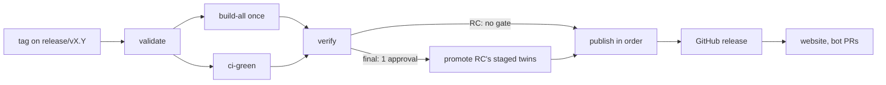

# One-tag release train

> **Status:** Proposed. Nothing below is implemented unless marked *exists today*.
>
> **Priority:** P1, starting right after v0.25.1 final ships.
>
> **Tracks:** [#5172](https://github.com/amd/gaia/issues/5172) (folds in [#5170](https://github.com/amd/gaia/issues/5170); [#3922](https://github.com/amd/gaia/issues/3922) closed as its duplicate). Eval baseline: [#5197](https://github.com/amd/gaia/issues/5197).

## Why

A GAIA release candidate now ships in about 30 minutes with no approval (v0.25.1-rc1 took 32 minutes, rc2 took 29). A final still takes most of a day and needs several approvals, because it runs three workflows that wait on each other in a fixed order.

- **v0.25.0 needed 19 RCs over 11 days.** The final then failed its first run in 40 seconds: the flagship agent 0.3.0 had never been published, and the committed lock still held `PENDING` hashes.
- **Recovering the v0.25.0 final took 17 hours.** The agent release failed three times, had one run cancelled, and passed on its fifth attempt (09:04 to 15:52). The core tag was moved and re-run (15:58 to 19:51), and the hub components finished at 01:30 the next day.
- **v0.25.1 hit the same issues again.** The flagship has its own version (0.3.1) and tag, and `check_flagship_release.py` fails the final if anything the agent binary is built from changes after that tag. That freezes `main`.
  - rc1 and rc2 differ in 9 of those files, so the agent tag can't go on rc1's commit.
  - The core release PR and the agent bump PR had to merge in a set order.
  - The lock-PR branch collided with the `release` branch (#5473).
  - rc1 shipped without the Intel Mac agent (pymupdf 2.0, fixed in #5481).
- **Versions are hand-synced in about 11 places.** The chat agent still says 0.1.0 in `__init__.py` but 0.2.0 everywhere else.

The train removes the order dependencies. It doesn't add more checks on top of them.

## 1. Target pipeline

One `vX.Y.Z-rcN` or `vX.Y.Z` tag runs one workflow (`publish.yml`, which keeps its name because the PyPI and npm trusted publishers are bound to it).

| Stage | What it does |
|---|---|
| **validate** | Classify the tag (`util/release_tag.py`, *exists today*). Check the tag is on `release/vX.Y`. Run `release_versions.py --check`, which replaces both version checks. Notes and `docs.json` pass. A final must point at the same SHA as an RC whose run succeeded. |
| **build-all** (RC only) | Every artifact below, built **once**, at the RC version **and** as a final-stamped twin (see [Promotion](#3-promotion)). |
| **verify** | Clean-runner installs and smokes for every artifact; a twin-diff; SHA-256 checksums and Sigstore signatures. `binaries.lock.json` is **generated here** from this run's own sidecar and TUI artifacts. |
| **publish** | Fixed order. Every step skips bytes that are already published and fails on different bytes, so a re-run resumes where it stopped. |

**Artifacts (one version, one build):**

| Artifact | Today | Train |
|---|---|---|
| `amd-gaia` wheel + sdist (PyPI) | `publish.yml` | same |
| `@amd-gaia/agent-ui` (npm) | `publish.yml` | same |
| `@amd-gaia/agent` (npm), `@amd-gaia/gaia` shim | `release_agent_gaia.yml`, own tag, `latest` only | train, RCs on `next` |
| Flagship sidecar (4 platforms) | built twice: `rc-flagship` and the agent release | once (`build_flagship_sidecar.yml`) |
| TUI binaries (6) | built 3 times (`publish.yml:649`, `rc-tui-binaries`, `release_components.yml:309`), with two naming schemes (`gaia-darwin-amd64` vs `gaia-darwin-x64`) | once, one naming scheme |
| TUI installers (.pkg/.deb/.rpm) + combined Windows setup | R2 only on a final; the setup is on GitHub only for an RC | both, in both places |
| Agent UI installers + `latest*.yml` | `build-installers.yml` | same |
| Hub entries (`gaia`, `terminal-hub`→`tui`, `agent-ui`) | `release_components.yml` + agent release | train |

**Publish order** (the same order as #5172):

1. GitHub **draft** release with every asset and `SHA256SUMS`.
2. Hub R2 objects under `agents/<id>/<version>/`, not yet referenced by a channel.
3. npm tarballs under a `staging` dist-tag.
4. PyPI: core wheel. **This is the point of no return.**
5. npm dist-tags: flip to `next` (RC) or `latest` (final).
6. Hub channel: `next` (RC) or `stable` (final). Needs the Worker change in Phase 4.
7. Publish the GitHub release (pre-release for an RC, `latest` for a final).
8. Website redeploy (Railway, `deploy_website.yml`) and the post-release bot PRs.

### Tag and branch model

- **`release/vX.Y`** is cut from `main` when the X.Y.0 release PR merges. RCs and finals are tagged on it. `main` moves on to X.(Y+1).0 straight away, through the bot PR.
  - The branch can't be created until the `release` pointer branch is gone. Git can't hold `release` and `release/v0.26` together (see `util/open_flagship_lock_pr.py:46`). See decision 1.
- **Fixes land on `main` first.** A `backport release/vX.Y` label makes a bot open a cherry-pick PR against the branch. Merges to `main` never touch a candidate.
- **rcN** is any tag `vX.Y.Z-rcN` on the branch. A newer RC supersedes an older one before publishing (*exists today*: `approve-publish` runs `release_tag.py superseded`).
- **Patch X.Y.1** comes from the same branch: the bot opens a version bump PR to the branch, then RC, then promote.
- **Hotfix** is the same as a patch. The RC is mandatory but can be promoted at once, with a recorded soak waiver. There are no four-part tags: `release_tag.py:42` accepts them today, but the train drops them.

### The flagship agent joins the core version

| Today | Train |
|---|---|
| Agent 0.3.1, its own `agent-pkg-gaia-v*` tag and workflow | Agent version = core version (the next release is **0.26.0**) |
| `binaries.lock.json` committed with `PENDING` hashes, filled by a bot PR | Not committed. Generated in `verify` from this run's artifacts and shipped in the npm tarball and the setup |
| `check_flagship_release.py` (agent tag vs core tag, frozen-input diff) | Deleted. The agent is built from the tagged commit by construction |
| `open_flagship_lock_pr.py` + the `pin-lock` job | Deleted |
| npm `@amd-gaia/gaia` 0.3.0 | `@amd-gaia/agent` 0.26.0 (new name, so no visible jump). `@amd-gaia/gaia` gets one final 0.26.0 shim and `npm deprecate` |
| Hub `gaia` 0.1.1 to 0.3.0 | 0.26.0 is the next entry; highest-SemVer still picks it |

**The 0.3 to 0.26 jump is deliberate and safe.** SemVer only asks that versions increase.

- An integrator on `^0.3.0` stays on 0.3.x, because a caret on 0.x is minor-locked, until they switch to `@amd-gaia/agent`. That's the deprecation path we want.
- The wire contract stays independent (`API_VERSION` in `gaia_agent/server.py`, the lock `schemaVersion`, the daemon host API), so compatibility is still expressed where it's real.
- The agent CHANGELOG says this in one line.

The chat agent follows core too, which fixes its 0.1.0/0.2.0 drift. Email is decision 3.

## 2. One version source

`src/gaia/version.py` (`__version__`, `LEMONADE_VERSION`) is the only version anyone edits. A new `util/release_versions.py` replaces `installer/version/bump-ui-version.mjs`, `hub/agents/{gaia,chat}/python/packaging/stamp_version.py` and the stamping half of `release_tag.py`.

| Generated file / field | Today written by |
|---|---|
| `src/gaia/apps/webui/package.json` + lock root version | `bump-ui-version.mjs` |
| `hub/components/{terminal-hub,agent-ui}/gaia-agent.yaml` `version` | hand `sed` (gaia-release skill, step 6) |
| Flagship: `gaia_agent/__init__.py`, `pyproject.toml`, `gaia-agent.yaml` (`version`, `min_gaia_version`), `npm/package.json` + lock, doc URLs | `stamp_version.py` + hand bump |
| Chat agent: same three files | hand (currently drifted) |
| `docs/docs.json` navbar label (latest **final** · Lemonade) | hand |
| `binaries.lock.json` | release bot PR → now generated at build time, not committed |

- **Modes:**
  - `write` stamps the tree.
  - `--check` fails on any drift and runs in `lint.yml` and a unit test.
  - `--stamp <tag>` writes RC versions (`0.26.0rc1` for PyPI, `0.26.0-rc.1` for npm, `0.26.0~rc1` for deb/rpm) into every generated field at build time. Today only `version.py` and webui are stamped (`release_tag.py:159`).
- **Not generated:** the TUI version (already set from the tag via `-ldflags`), teaching templates (`hello-world`, `word-count`, `connectors-demo`), skills, and any third-party agent.
- **`check_component_core_api.py` stays.** It already reads released daemon API versions from PyPI rather than a table.
- **The next-version bot** runs after a final publishes. It opens one PR to `main`: navbar, a release-notes stub, and `version.py` bumped if `main` isn't already ahead. For a patch, it opens a second PR to the branch.
  - `docs.yml` and `test_docs_json_release.py` currently resolve `docs/releases/v<__version__>.mdx` on `main`. They must accept a `main` that's ahead of the latest release.

## 3. Promotion

A final can't relabel RC bytes:

- PyPI and npm versions are immutable.
- The wheel `METADATA`, `package.json`, the Electron app, `latest*.yml` (which carries a sha512), the Go `-X version` and the PyInstaller sidecar all embed the version.

So each RC run also builds a **final-stamped twin** from the same checkout, verifies it, and stages it. Promotion publishes the staged twin without rebuilding or re-running tests.

- **Staging:** the twins go on a **draft** GitHub release `vX.Y.Z`, with `release-manifest.json` listing the RC tag, SHA, toolchain and lockfile hashes, and each artifact's SHA-256. Drafts don't expire (workflow artifacts do). Each new RC replaces the draft's assets.
- **Twin-diff:**
  - **Archives** (wheel, sdist, npm tarballs, Electron `app.asar`): unpacked trees must match once version strings are normalised.
  - **Native binaries:** byte-level proof isn't possible. PyInstaller, NSIS, DMG and signing timestamps aren't reproducible. Go with `-trimpath` and the commit date is reproducible, so the RC run rebuilds one TUI target to prove determinism.
  - Native twins are proven by: same SHA, same lockfiles, `version` reports X.Y.Z, and the same clean-runner smoke the RC artifact passed.
- **Final tag `vX.Y.Z`:**
  - `validate` requires the SHA to equal the RC named in the draft's manifest. A final on any other commit fails and tells you to cut an RC.
  - One approval (`publish` environment), then the publish order above from the staged twins, after re-checking every hash against the manifest.
  - Release notes come from `docs/releases/vX.Y.Z.mdx` at the branch tip, so docs-only commits after the RC are fine. Nothing else is read from the tip.
- **Channels:**

| | RC | Final |
|---|---|---|
| PyPI | `X.Y.ZrcN` | `X.Y.Z` |
| npm | `X.Y.Z-rc.N` on `next` | `latest` |
| GitHub | pre-release | `latest` |
| Hub | `next` channel | `stable` |
| deb/rpm | `X.Y.Z~rcN` | `X.Y.Z` |
| Electron update file | `next*.yml` | `latest*.yml` |

- **Electron auto-update:** the forward feed isn't live yet (`electron-builder.yml:84-104`, #1719). The updater shows `NO_CHANNEL` unless a feed URL is configured. RC pre-releases attach `latest*.yml` today, so RC builds must switch to the `next` channel before the feed ships; otherwise an RC would be offered as the stable update. At promote, the twin's `latest*.yml` goes on the GitHub release, and the hub pointer is updated once #1719 lands.
- **Can't be promoted:**
  - an RC tagged `[skip eval]`;
  - an RC whose twin build or twin-diff failed;
  - an RC older than the newest RC of its X.Y.Z;
  - any change to code. Code changes need a new RC.
- **Fallback:** an explicit `rebuild_final: true` dispatch input exists for when staging itself is broken. It runs the full build on the final tag, and the run summary names it as a rebuild. It's an opt-in, never automatic.

## 4. Eval gate

Evals inform the promotion decision and record it. They never block an RC.

- **Every RC tag** runs `eval_flagship.yml` (*exists today*, `eval_flagship.yml:168-171`). It covers all `eval/ci_lanes.json` lanes and `flagship-tasks`, compared with `tests/fixtures/eval_baselines/gaia-flagship/` under the same `EVAL_MODEL`, in report mode. A regression files `Flagship eval did not pass on <tag>`.
- **The agent release's separate eval subset goes away** with `release_agent_gaia.yml`. That's also where #5197's wrong baseline directory lives (`test_gaia_agent_eval.yml` points at `gaia-gemma-4-e4b`). Fix #5197 first, in Phase 3, so the subset compares while it still exists.
- **Promote requires** an eval run on the RC's SHA that has *concluded*: `success`, or `failure` with the eval issue labelled `release-waived` by a maintainer. Cancelled or still running blocks promotion.
  - The promote summary lists PASS→FAIL and FAIL→PASS against the baseline separately, per CLAUDE.md.
  - A lone flip gets a re-run before anyone calls it a regression.
  - The 80% target stays a goal, not a gate.
- **A final tag doesn't re-run the eval** when its SHA already has a concluded RC run. Today `v*.*.*` matches the final and spends another ~3 hours of Strix Halo time on identical code (v0.25.0 final: 3 h 20 min).

## 5. Phases

Each phase is one mergeable PR that leaves releases working. **S** ≤ 1 day, **M** 2–4 days, **L** 1–2 weeks.

| # | PR | Size | Lands | Acceptance |
|---|---|---|---|---|
| 1 | `util/release_versions.py` (`write`, `--check`, `--stamp`) + drift check in `lint.yml` + unit tests. Report-only for the flagship and chat targets, which stay independent until Phase 3. Fixes the chat `__init__` drift. | M | **Before v0.25.1 final** (tooling only, no release workflow touched) | `--check` passes on `main`. Each target drifted by hand makes it fail, naming the file. `--stamp v0.26.0-rc1` on a copy matches today's `release_tag.py stamp` byte-for-byte for the files they share. |
| 2 | `release_train_dryrun.yml`: dispatch-only, `contents: read`, no environments or publish secrets. Builds every artifact once plus twins, generates the lock, runs verify and twin-diff, uploads a manifest. | L | **Before v0.25.1 final** (new file, can't publish) | A green dispatch on `main` produces the full artifact list, one TUI build, a lock with real hashes, and a passing twin-diff. A deliberately altered twin fails it. |
| 3 | After final: version unification. The flagship and chat agents follow core (0.26.0 on `main`). `stamp_version.py` and `bump-ui-version.mjs` become wrappers. Next-version bot. Fix #5197. Retarget or retire `nightly-patch-release.yml` (Guard 4 at `:154` assumes a steady-state `main`). | M | after v0.25.1 final | `--check` covers the agents. The bot PR opens after a dispatch dry run. The old `agent-pkg-gaia-v0.26.0` path would still validate, so nothing breaks before Phase 5. |
| 4 | Hub Worker: a `channels` map (`stable`, `next`), with `latest_version` kept equal to `stable` for existing clients. A neutral `agents/tui/` path, with `agents/terminal-hub/` written as an alias for one cycle. | M | after final (the Worker is deployed by `release_components.yml:224` during a final, so any earlier merge would ship with v0.25.1) | Worker vitest covers that an RC never becomes `latest_version`, and old paths resolve. A dry-run deploy passes. |
| 5 | The train in `publish.yml`: Phase 2's build stages + verify + the publish order + `@amd-gaia/agent` (name claimed with a one-time token first, then OIDC). Hub secrets move to a reviewer-less `hub-publish` environment, so `agent-publish` (2 reviewers) leaves the `v*` path. `release_components.yml` and `release_agent_gaia.yml` drop their tag triggers but stay dispatchable. | L | after Phase 4. First live use: **v0.26.0-rc1** | An RC publishes everything on pre-release channels with zero prompts. Killing the run during step 3 and re-running finishes with no tag moved. The GitHub release carries every asset the website links. |
| 6 | `release/vX.Y` branches (after decision 1), validate-on-branch, staged twins, the promote path on a final tag, the backport bot, the eval promotion check, and skipping the eval on a final. | L | after one RC on Phase 5 | v0.26.0 final = rcN's SHA, one approval, no build jobs. A final on a non-RC SHA is refused. |
| 7 | Delete: `release_components.yml`, `release_agent_gaia.yml`, `check_flagship_release.py`, `open_flagship_lock_pr.py`, the committed lock, `update-release-branch.yml` and the `agent-pkg-gaia-*` docs. Write `docs/reference/releasing.mdx` and rewrite the `gaia-release` and `agent-hub-release` skills. | M | after v0.26.0 final ships on the train | The acceptance in #5172: one tag, one approval, `git grep agent-pkg-gaia` shows only history. |

**Before v0.25.1 final, only Phases 1 and 2.** Neither edits a live workflow or a file a live workflow reads: the drift check is report-only for the agent targets, and the dry run has no credentials.

## 6. Risks and rollback

| Phase | Risk | Rollback |
|---|---|---|
| 1 | The drift check flags a legitimate edit and blocks unrelated PRs | Remove the `lint.yml` step (one line). The generator stays. |
| 2 | Burns macOS and Windows minutes; someone adds a secret later | `permissions: contents: read` and no `environment:` are asserted by a unit test. Delete the file to roll back. |
| 3 | Agent at 0.26.0 before the train exists | Compatible with the old path (`agent-pkg-gaia-v0.26.0`). Revert before anything publishes 0.26.0, because hub paths are immutable after that. |
| 4 | Older clients read `latest_version` and get an RC | `latest_version` stays `stable`, enforced by a Worker test. `wrangler rollback` restores the previous build. |
| 5 | Trusted-publisher mismatch, npm name claim, first live run | First use is an RC (pre-release channels only). The old workflows stay dispatchable for a final. Revert `publish.yml` to restore today's flow. |
| 6 | Twin staging corrupts or misses; promote half-publishes | Promote resumes on re-run (same-bytes skip). `rebuild_final: true` is the explicit escape hatch. Reverting restores Phase 5's rebuild-on-final. |
| 7 | Something still read a deleted file | `git revert`. Phase 7 waits for a full final on the train. |

**Dry-run matrix before first real use** (Phase 2's workflow, plus a `train-test-*` tag pattern that only ever runs `dry_run: true`):

- [ ] Full build-all + verify on `main` and on a `release/v0.26` test branch.
- [ ] Twin-diff passes; a hand-edited twin fails it.
- [ ] Generated lock hashes match the uploaded artifacts.
- [ ] A superseded RC stops before publish; two RC tags pushed a minute apart.
- [ ] A final tag on a non-RC SHA is refused; on the RC's SHA it takes the promote path.
- [ ] Cancel during each publish step, then re-run: completes, no tag moves (against TestPyPI and a hub `staging/` prefix).
- [ ] A missing required platform fails verify; a missing best-effort `darwin-x64` is named in the release body.

## 7. Open decisions

1. **Release branch name.** `release/vX.Y` needs the force-pushed `release` pointer branch deleted (`update-release-branch.yml:43-44`). Nothing in the repo reads it. **Recommend:** delete `release` and point people at GitHub's "latest release". Otherwise use `releases/vX.Y`.
2. **Final = promoted twins, or a rebuild on the final tag.** Twins roughly double native build minutes per RC and only partially prove native binaries. A rebuild retests code that was already tested. **Recommend:** twins. The point is that the final runs bytes testers already ran.
3. **Which agents ride the train.** Agent wheels aren't on PyPI today, and their names are unclaimed (`setup.py:18-26`, #2240). Email is on its own tag at 0.6.0. **Recommend:** flagship (npm + sidecar) and chat only. Email stays on `agent-pkg-email-*` like a community agent until its own decision. Agent wheels on PyPI are a separate issue.
4. **`@amd-gaia/agent` bin name.** `gaia` shadows the core CLI on PATH. **Recommend:** `gaia-agent`. The deprecated `@amd-gaia/gaia` shim keeps `gaia` for existing scripts.
5. **How strict is the promote eval check?** **Recommend:** a concluded run, or a maintainer's `release-waived` label, with no score threshold. Blocking on the 59% baseline or the 80% target would just make the check always red.

## What's riskier than #5172 assumes

- **"No rebuild" can't mean byte-identical.** Every channel embeds the version, so the final is a twin built alongside the RC. Native twins can only be proven by provenance and smoke tests, not by diff.
- **A final costs 3–4 approvals today, not 1.**
  - `publish` and `agent-publish` each require 2 reviewers.
  - `agent-publish` gates `release_components.yml`'s `terminal-hub`, `agent-ui` and `publish-windows-setup` jobs (`:366`, `:610`, `:520`) and the agent release (`release_agent_gaia.yml:713`).
  - GitHub prompts once per batch of jobs that pend together.
- **Final GitHub releases lack the TUI installers and the combined Windows setup.** Those go to R2 only. Moving website links to GitHub assets 404s for finals until Phase 5 attaches them.
- **The Worker deploys inside the final** (`release_components.yml:224`), so hub-channel work can't merge before v0.25.1 final.
- **The branch model breaks every "is on main" check:** `publish.yml:106-112`, `release_agent_gaia.yml:724-736`, the docs checks that read `__version__`, and `check_release_ci.py`, which needs CI runs on branch commits.
- **v0.25.1 final right now:** `agent-pkg-gaia-v0.3.1` isn't tagged yet. It must go on rc2's commit (`0b14d740d`) or later, because rc1's commit differs in 9 frozen-input files. `main` has to stay frozen on `src/gaia` and `setup.py` until the core tag.
